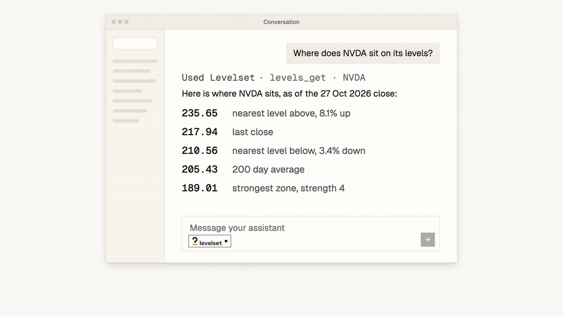

<div align="center">

<picture>
  <source media="(prefers-color-scheme: dark)" srcset="./assets/brand/levelset-horizontal-reversed.svg">
  <source media="(prefers-color-scheme: light)" srcset="./assets/brand/levelset-horizontal.svg">
  
</picture>

### In Worten fragen. Das Level erhalten.

Der MCP-Connector für Kursniveaus, nur lesend, von [StandPoint](https://standpointhq.com).

[English](README.md) | [Français](README.fr.md) | **Deutsch**

[](https://registry.modelcontextprotocol.io/v0.1/servers?search=com.standpointhq/levelset)
[](https://mcp.standpointhq.com)
[](#tools)
[](#claude)
[](#chatgpt)
[](LICENSE)

<a href="https://mcp.standpointhq.com/#film"></a>

[**▶ Film ansehen (57 s)**](https://mcp.standpointhq.com/#film) · [**In vier Schritten verbinden**](#verbinden) · [**Kostenloses Konto**](https://standpointhq.com/join)

</div>

## Was es ist

Levelset bringt den Research-Desk von StandPoint in Claude, ChatGPT oder jeden Assistenten, der das [Model Context Protocol](https://modelcontextprotocol.io) spricht. Sie fragen in eigenen Worten nach einer Aktie, und die Antwort kommt mit ihren Kursniveaus zurück, gelesen aus den Daten des Desks statt geraten.

Jeder Pick trägt den genauen Zeitpunkt seiner Veröffentlichung und den Kurs zu diesem Zeitpunkt, prüfbar in einem öffentlichen Register.

Levelset wird gehostet. Dieses Repository enthält Dokumentation, den Registry-Eintrag und Codebeispiele. Es gibt nichts zu installieren; eine Adresse genügt.

```text
https://standpointhq.com/api/v1/mcp
```

## Verbinden

### Claude

1. Öffnen Sie **Einstellungen**, dann **Connectors**, dann **Benutzerdefinierten Connector hinzufügen**.
2. Nennen Sie ihn `Levelset`, fügen Sie die Adresse ein und wählen Sie **Hinzufügen**.
3. Wählen Sie **Verbinden**. Claude leitet Sie zu standpointhq.com: mit der E-Mail Ihres Kontos anmelden und bestätigen.
4. Zurück in Claude im **+** Menü eines Chats Levelset einschalten.

Benutzerdefinierte Connectors erfordern einen kostenpflichtigen Claude-Plan.

### ChatGPT

1. **Einstellungen**, dann **Connectors**. Unter **Erweitert** den **Entwicklermodus** einschalten.
2. **Erstellen** wählen, `Levelset` nennen, Adresse einfügen, **Authentifizierung** auf **OAuth** setzen.
3. Auf standpointhq.com anmelden und bestätigen.
4. Im Chat Levelset im Connector-Menü aktivieren.

### Claude Code

```bash
claude mcp add --transport http levelset https://standpointhq.com/api/v1/mcp
```

### Andere Clients

Adresse dort einfügen, wo der Client einen MCP-Server erwartet. Bietet er eine Anmeldung an, nutzen Sie sie. Nimmt er nur einen Header, erstellen Sie unter **Konto, Sicherheit** auf standpointhq.com einen API-Schlüssel und senden ihn als `Authorization: Bearer spk_…`.

## Tools

Alle neun Tools tragen `readOnlyHint: true` und `destructiveHint: false`.

| Tool | Antwort | Kostenloses Konto |
| --- | --- | :---: |
| `picks_today` | Die heutigen Picks mit Zeit und Kurs der Veröffentlichung | mit einem Book |
| `picks_open` | Alle offenen Positionen mit Kursziel und Stop | mit einem Book |
| `picks_closed` | Das Archiv geschlossener Picks | ✓ |
| `picks_record` | Die öffentliche Bilanz je Book | ✓ |
| `overdrive_mine` | Ihre Overdrive-Liste gegenüber SPY | mit einem Book |
| `ticker_profile` | Alles zu einem Titel in einem Aufruf | ✓ |
| `levels_get` | Pivot-Zonen, Periodeneröffnungen, Sigma-Bänder, 50/100/200-Tage-Durchschnitte | ✓ |
| `screen` | Der Screener, gefiltert nach Book, Sektor oder Thema | ✓ |
| `books_mine` | Die Books Ihres Kontos | ✓ |

Beispiele für Python, TypeScript und Shell, ohne Abhängigkeiten: [`examples/`](examples).

## Kosten

Tools und Archiv sind kostenlos. Die Live-Abfragen (heutige Picks, offene Positionen, Overdrive) gehören zu einem Book: dem S&P Book oder dem Nasdaq Book. Siehe [Preise](https://standpointhq.com/pricing). Live ist nie kostenlos, und es gibt keine Testphase.

## Kann es für mich handeln?

Nein. Es liest. Levelset hat kein schreibendes Tool: Es kann keine Order platzieren, vorbereiten oder simulieren und ändert nichts an Ihrem Konto. Information, keine Anlageberatung.

## Lizenz

Die Beispiele stehen unter der [MIT-Lizenz](LICENSE). Namen und Logos von Levelset und StandPoint, die Filmbilder und der gehostete Dienst sind davon nicht erfasst.

<div align="center">
<br>
<sub>Levelset ist ein Produkt von StandPoint, entwickelt in Genf.</sub>
</div>
