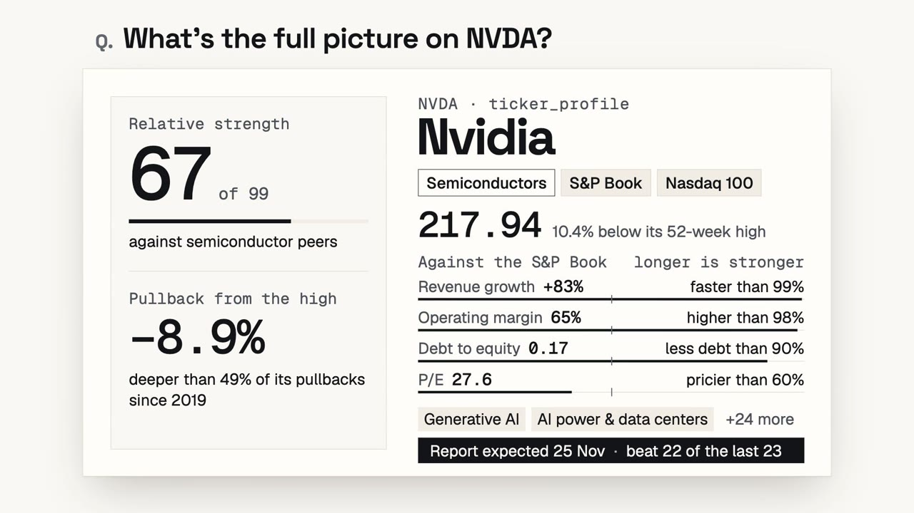
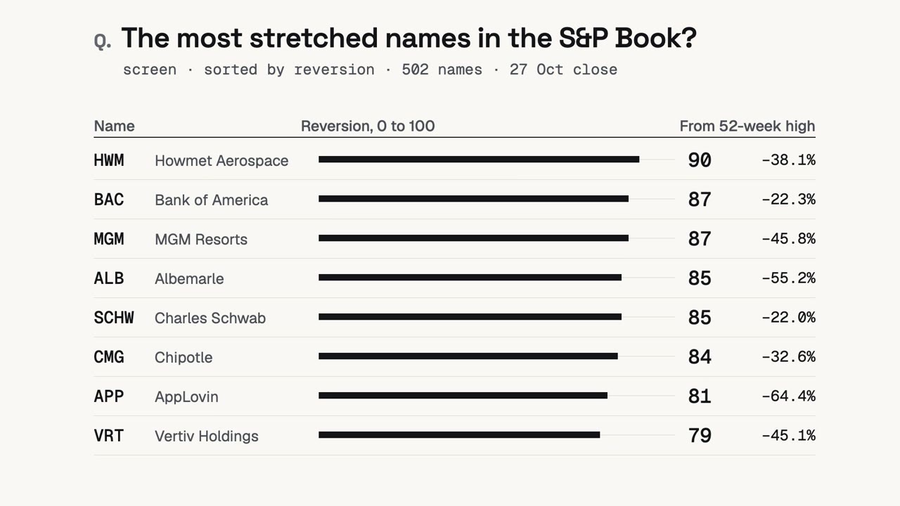
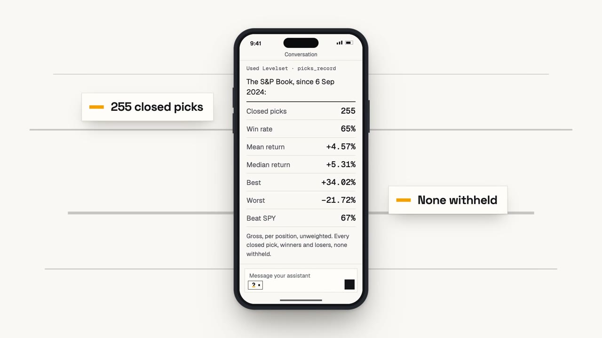
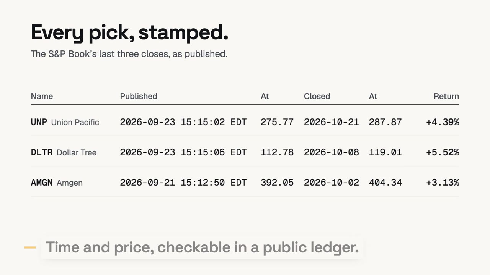

<div align="center">

<picture>
  <source media="(prefers-color-scheme: dark)" srcset="./assets/brand/levelset-horizontal-reversed.svg">
  <source media="(prefers-color-scheme: light)" srcset="./assets/brand/levelset-horizontal.svg">
  
</picture>

### Posez la question. Obtenez le niveau.

Le connecteur MCP en lecture seule pour les niveaux de cours, par [StandPoint](https://standpointhq.com).

[English](README.md) | **Français** | [Deutsch](README.de.md)

[](https://registry.modelcontextprotocol.io/v0.1/servers?search=com.standpointhq/levelset)
[](https://mcp.standpointhq.com)
[](#outils)
[](#claude)
[](#chatgpt)
[](LICENSE)

<a href="https://mcp.standpointhq.com/#film"></a>

[**▶ Voir le film (57 s)**](https://mcp.standpointhq.com/#film) · [**Se connecter en quatre étapes**](#se-connecter) · [**Créer un compte gratuit**](https://standpointhq.com/join)

</div>

## Ce que c'est

Levelset installe le desk de recherche de StandPoint dans Claude, ChatGPT ou tout assistant compatible avec le [Model Context Protocol](https://modelcontextprotocol.io). Vous posez une question sur une action, avec vos mots, et la réponse revient avec ses niveaux de prix, lus dans les données du desk plutôt que devinés.

Chaque pick renvoyé porte l'instant exact de sa publication et le prix à ce moment-là : vous pouvez le vérifier dans un registre public.

Levelset est hébergé. Ce dépôt contient la documentation, la fiche du registre MCP et des exemples de code. Il n'y a rien à installer : une seule adresse suffit.

```text
https://standpointhq.com/api/v1/mcp
```

## Se connecter

### Claude

Sur le web, dans l'application de bureau, sur iPhone et Android.

1. Ouvrez **Paramètres**, puis **Connecteurs**, puis **Ajouter un connecteur personnalisé**.
2. Nommez-le `Levelset`, collez l'adresse et choisissez **Ajouter**.
3. Choisissez **Connecter**. Claude vous envoie sur standpointhq.com : connectez-vous avec l'e-mail de votre compte et validez.
4. De retour dans Claude, ouvrez le menu **+** d'une conversation et activez Levelset.

Les connecteurs personnalisés demandent un abonnement Claude payant.

### ChatGPT

Avec le mode développeur activé.

1. Ouvrez **Paramètres**, puis **Connecteurs**. Sous **Avancé**, activez le **Mode développeur**.
2. Choisissez **Créer**. Nommez-le `Levelset`, collez l'adresse, réglez l'**Authentification** sur **OAuth**, puis **Créer**.
3. ChatGPT vous envoie sur standpointhq.com : connectez-vous et validez.
4. Dans une conversation, activez Levelset depuis le menu des connecteurs.

### Claude Code

```bash
claude mcp add --transport http levelset https://standpointhq.com/api/v1/mcp
```

### Tout autre client

Collez l'adresse là où le client demande un serveur MCP. S'il propose de se connecter, faites-le. S'il n'accepte qu'un en-tête, créez une clé d'API dans **Compte, Sécurité** sur standpointhq.com et envoyez-la sous la forme `Authorization: Bearer spk_…`.

Pas encore de compte ? [Créez-en un gratuitement](https://standpointhq.com/join). Sans carte.

## Ce que vous pouvez demander

<table>
<tr>
<td width="50%"><br><b>Le portrait complet d'un titre.</b> Prix, niveaux, fondamentaux classés face au book, prochaine publication, thèmes et avis du desk, en un seul appel. <code>ticker_profile</code></td>
<td width="50%"><br><b>Les titres les plus tendus.</b> Le screener d'un book, trié par réversion, niveaux, résultats ou force relative. <code>screen</code></td>
</tr>
<tr>
<td width="50%"><br><b>Le bilan, honnêtement.</b> Tous les picks clôturés depuis le lancement, gagnants et perdants, sans exception. <code>picks_record</code></td>
<td width="50%"><br><b>Chaque pick, horodaté.</b> L'heure et le prix de publication, vérifiables dans un registre public. <code>picks_closed</code></td>
</tr>
</table>

Les chiffres de ces images sont de vraies réponses du connecteur, sur la clôture du 27 octobre 2026.

## Outils

Les neuf outils portent `readOnlyHint: true` et `destructiveHint: false`.

| Outil | Ce qu'il renvoie | Compte gratuit |
| --- | --- | :---: |
| `picks_today` | Les picks du jour, avec l'heure et le prix de publication | avec un book |
| `picks_open` | Les positions en cours : prix publié, dernière clôture, rendement latent, objectif et stop | avec un book |
| `picks_closed` | L'archive des picks clôturés | ✓ |
| `picks_record` | Le bilan public par book | ✓ |
| `overdrive_mine` | Votre liste Overdrive face au SPY | avec un book |
| `ticker_profile` | Tout sur un titre, en un appel | ✓ |
| `levels_get` | Zones pivots, ouvertures de période, bandes sigma et moyennes 50, 100 et 200 jours | ✓ |
| `screen` | Le screener, filtré par book, secteur ou thème | ✓ |
| `books_mine` | Les books de votre compte | ✓ |

## Depuis votre code

Levelset répond en JSON-RPC sur HTTPS : n'importe quel langage peut l'appeler avec une clé d'API. Voir [`examples/`](examples) (Python, TypeScript, shell), sans dépendance.

## Coût

Les outils et l'archive sont gratuits. Les appels en direct (picks du jour, positions ouvertes, Overdrive) viennent avec un book : le S&P Book et le Nasdaq Book, au prix fixé par le nombre de books détenus. Voir les [tarifs](https://standpointhq.com/pricing). Rien de ce qui est en direct n'est gratuit, et il n'y a pas d'essai.

## Peut-il passer des ordres ?

Non. Il lit. Levelset n'a aucun outil d'écriture : il ne peut ni passer, ni préparer, ni simuler un ordre, et ne modifie rien sur votre compte. Vous l'autorisez une fois, et vous pouvez le déconnecter quand vous voulez.

Information, pas un conseil.

## Licence

Les exemples sont sous [licence MIT](LICENSE). Les noms et logos Levelset et StandPoint, les images du film et le service hébergé n'en font pas partie.

<div align="center">
<br>
<sub>Levelset est un produit StandPoint, conçu à Genève.</sub>
</div>
