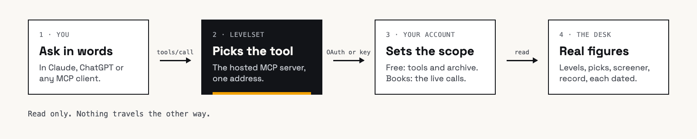
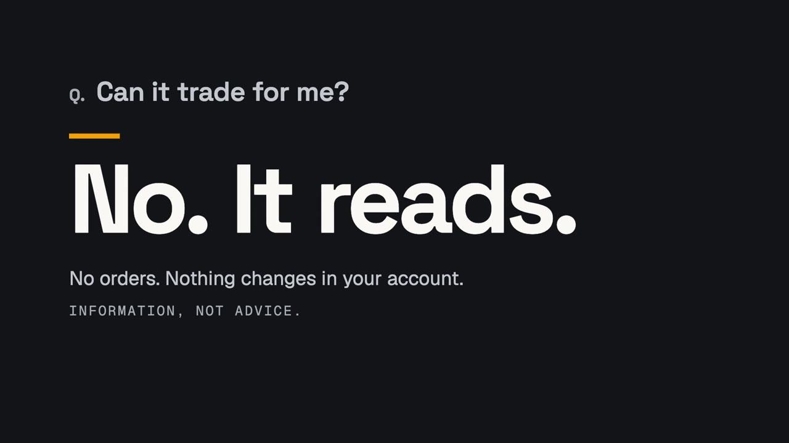

<div align="center">

<picture>
  <source media="(prefers-color-scheme: dark)" srcset="./assets/brand/levelset-horizontal-reversed.svg">
  <source media="(prefers-color-scheme: light)" srcset="./assets/brand/levelset-horizontal.svg">
  
</picture>

### Ask in words. Get the level.

The read only MCP connector for stock levels, by [StandPoint](https://standpointhq.com).

**English** | [Français](README.fr.md) | [Deutsch](README.de.md)

[](https://registry.modelcontextprotocol.io/v0.1/servers?search=com.standpointhq/levelset)
[](https://mcp.standpointhq.com)
[](#tools)
[](#connect)
[](#connect)

[](#claude)
[](#chatgpt)
[](#claude-code)
[](LICENSE)

<a href="https://mcp.standpointhq.com/#film"></a>

[**▶ Watch the 57 second film**](https://mcp.standpointhq.com/#film) · [**Connect in four steps**](#connect) · [**Create a free account**](https://standpointhq.com/join)

</div>

## What it is

Levelset puts StandPoint's market research desk inside Claude, ChatGPT or any assistant that speaks the [Model Context Protocol](https://modelcontextprotocol.io). Ask about a stock in plain words and the answer comes back with its price levels, read from the desk's data instead of guessed.

Every pick it returns carries the instant it was published and the price it was published at, so you can check it against a public ledger.

```text
You       Where does NVDA sit on its levels?
Claude    Used Levelset · levels_get · NVDA
          Here is where NVDA sits, as of the 27 Oct 2026 close:
          235.65   nearest level above, 8.1% up
          217.94   last close
          210.56   nearest level below, 3.4% down
          205.43   200 day average
          189.01   strongest zone, strength 4
```

This repository holds the connector's documentation, its registry entry and client examples. Levelset itself is hosted: the address below is all a client needs, and there is nothing to install or run.

```text
https://standpointhq.com/api/v1/mcp
```

## How it works



1. Your assistant picks the tool that answers the question.
2. Levelset checks what your account may read: the tools and the archive on a free account, the live calls once you hold a book.
3. It returns the desk's own figures, each with its date, and the assistant writes them up.

Nothing travels the other way. Levelset has no tool that writes.

## Connect

### Claude

On the web, in the desktop app, on iPhone and Android.

1. Open **Settings**, then **Connectors**, then **Add custom connector**.
2. Name it `Levelset`, paste `https://standpointhq.com/api/v1/mcp` and choose **Add**.
3. Choose **Connect**. Claude sends you to standpointhq.com: sign in with the email on your account and approve.
4. Back in Claude, open the **+** menu in a chat and switch Levelset on.

Custom connectors need a paid Claude plan. Nine ready made questions then appear in the **+** menu.

### ChatGPT

With developer mode on.

1. Open **Settings**, then **Connectors**. Under **Advanced**, switch **Developer mode** on.
2. Choose **Create**. Name it `Levelset`, paste the address, set **Authentication** to **OAuth**, then **Create**.
3. ChatGPT sends you to standpointhq.com: sign in with the email on your account and approve.
4. In a chat, enable Levelset from the connectors menu and ask.

Menu names as of October 2026; they may move.

### Claude Code

```bash
claude mcp add --transport http levelset https://standpointhq.com/api/v1/mcp
```

Sign in when it asks, approve, then ask in the session: *"What did the desk publish today?"*

### Any other client

Cursor, a script, a spreadsheet. Paste the address where the client asks for an MCP server.

- If it offers to sign in, use that: you approve on standpointhq.com and there is nothing to copy.
- If it only takes a header, make an API key under **Account, Security** on standpointhq.com and send it as `Authorization: Bearer spk_…`. Up to five keys per account, shown once, revocable.

<details>
<summary>JSON config, for clients set up with an <code>mcpServers</code> file (Cursor and similar)</summary>

```json
{
  "mcpServers": {
    "levelset": {
      "url": "https://standpointhq.com/api/v1/mcp",
      "headers": { "Authorization": "Bearer spk_YOUR_KEY" }
    }
  }
}
```

Leave out `headers` if the client signs in with OAuth.

</details>

No account yet? [Create one free](https://standpointhq.com/join). No card.

## What you can ask

<table>
<tr>
<td width="50%"><br><b>The full picture on a name.</b> Price, levels, fundamentals ranked against the book, the next report, themes and the desk's view, in one call. <code>ticker_profile</code></td>
<td width="50%"><br><b>The most stretched names.</b> The screener across a book, sorted by reversion, levels, earnings or relative strength. <code>screen</code></td>
</tr>
<tr>
<td width="50%"><br><b>The track record, honestly.</b> Every closed pick since inception, winners and losers, none withheld. <code>picks_record</code></td>
<td width="50%"><br><b>Every pick, stamped.</b> The time and price each pick was published, checkable in a public ledger. <code>picks_closed</code></td>
</tr>
</table>

Or ask it your own way:

- *Where does NVDA sit on its levels?*
- *Anything in the Nasdaq Book near its 200 day?*
- *The strongest name in semiconductors.*
- *Which of my names report in the next week?*
- *What is the track record, honestly?*

The figures in these pictures are real connector output for the 27 October 2026 close.

## Tools

All nine tools carry `readOnlyHint: true` and `destructiveHint: false`.

| Tool | What it answers | Free account |
| --- | --- | :---: |
| `picks_today` | Today's picks, with the time and price each was published | with a book |
| `picks_open` | Every position held now: published price, last close, unrealised return, target and stop | with a book |
| `picks_closed` | The archive of closed picks, newest first, filterable by date | ✓ |
| `picks_record` | The public record per book: inception, win rate, mean and excess return, the recent closes | ✓ |
| `overdrive_mine` | Your Overdrive list against SPY, with each name's return | with a book |
| `ticker_profile` | Everything about one name in one call | ✓ |
| `levels_get` | Pivot zones, period opens, sigma bands and the 50, 100 and 200 day averages | ✓ |
| `screen` | The screener: filter by book, sector or theme; sort by reversion, levels, earnings or relative strength | ✓ |
| `books_mine` | Which books your account holds | ✓ |

The connector also ships nine prompts (the ready made questions in Claude's **+** menu), each of which calls the tool that answers it.

## Use it from code

Levelset answers plain JSON-RPC over HTTPS, so any language can call it with an API key. Each example below runs with no dependencies.

| Language | File | Run |
| --- | --- | --- |
| Python 3.10+ | [`examples/python/levelset.py`](examples/python/levelset.py) | `python levelset.py NVDA` |
| TypeScript (Node 22.6+) | [`examples/typescript/levelset.ts`](examples/typescript/levelset.ts) | `node levelset.ts NVDA` |
| Shell (curl, jq) | [`examples/shell/levelset.sh`](examples/shell/levelset.sh) | `./levelset.sh levels_get '{"ticker":"NVDA"}'` |

```bash
export LEVELSET_API_KEY=spk_...   # Account, Security on standpointhq.com
curl -s https://standpointhq.com/api/v1/mcp \
  -H "Authorization: Bearer $LEVELSET_API_KEY" \
  -H "Content-Type: application/json" \
  -d '{"jsonrpc":"2.0","id":1,"method":"tools/call","params":{"name":"levels_get","arguments":{"ticker":"NVDA"}}}'
```

The server is stateless: every request stands alone, there is no session to open or close, and responses come back as `application/json`. Limit: 600 reads an hour per connection.

## Cost

| | Free | With a book |
| --- | :---: | :---: |
| The screener, levels and the full profile of any name | ✓ | ✓ |
| The themes, every closed pick and the public record | ✓ | ✓ |
| Today's picks, with the time and price each was published | | live |
| Open positions with target and stop | | live |
| Your Overdrive list, with the S&P Book | | live |

Two books, the S&P Book and the Nasdaq Book, priced by how many you hold. See [pricing](https://standpointhq.com/pricing). Nothing live is ever free, and there is no trial. A free account stays free.

## Can it trade for me?



No. Levelset has no tool that writes. It cannot place, stage or simulate an order, and it cannot change anything in your account. What you do with an answer is yours, at your own broker.

- **It reads only what your account can read.** The tools and the archive on a free account, the live calls once you hold a book.
- **You approve it once,** on a consent screen that lists what it reads.
- **You can disconnect it whenever you like.** The next call is refused.

## Check the record yourself

- [Every closed pick, as CSV](https://standpointhq.com/api/v1/public/record.csv)
- Each pick's `publishedAt` (UTC) and `priceAtPublish` come back with every answer that cites it.
- A hash of the record is taken each day, so a past row cannot be changed quietly.

## FAQ

<details>
<summary><b>Do I need a StandPoint account?</b></summary>

Yes, a free one. It reads every tool and the whole archive. [Create one](https://standpointhq.com/join), no card.
</details>

<details>
<summary><b>Which markets does it cover?</b></summary>

US equities in two books: the S&P Book (the S&P 500) and the Nasdaq Book (the Nasdaq 100 and growth names).
</details>

<details>
<summary><b>How fresh is the data?</b></summary>

Levels and the screener are drawn on the last close. Each answer says which session it was read on, and if one book is behind, it says which.
</details>

<details>
<summary><b>Is this investment advice?</b></summary>

No. Levelset reads what the desk has published; nothing it returns is a recommendation for you in particular.
</details>

<details>
<summary><b>Where is the server code?</b></summary>

Levelset is a hosted service and its server is not open source. This repository holds what a client needs: the address, the registry entry, documentation and examples.
</details>

## Links

- Website and setup: [mcp.standpointhq.com](https://mcp.standpointhq.com)
- MCP Registry: [`com.standpointhq/levelset`](https://registry.modelcontextprotocol.io/v0.1/servers?search=com.standpointhq/levelset)
- Help: [standpointhq.com/help](https://standpointhq.com/help)
- [Privacy](https://standpointhq.com/legal/privacy) · [Terms](https://standpointhq.com/legal/terms) · [Security](SECURITY.md) · [Changelog](CHANGELOG.md)

## License

The examples in this repository are under the [MIT License](LICENSE). The Levelset and StandPoint names, logos, film stills and the hosted service are not covered by it.

<div align="center">
<br>

<br>
<sub>Levelset is a StandPoint product, made in Geneva. Information, not advice.</sub>
</div>
